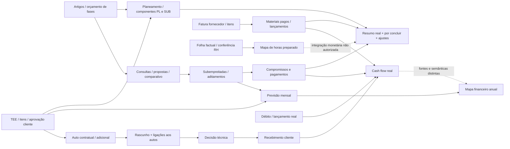

# Financeiro — circuito e achados

## Âmbito e classificação

CONFIRMADO significa código revisto ou comportamento reproduzido localmente. A instalação e os dados de produção são NÃO VERIFICADOS nesta missão. Nenhum valor monetário real foi consultado ou criado. Fontes: base de produto `2ae1f8a`, main local `1c5fa5b`, auditoria HR anterior preservada.

## Circuito e fontes de verdade

- MQT: `itens_orcamento`, `orcamento_fases`, `fases`; importadores e `fn_importar_orcamento_fases`. O hotfix anterior fase/obra deve ser preservado, não reimplementado.
- Planeamento: `planeamento_itens`, `planeamento_custos_componentes`, `fn_resumo_custos_obra`; versões de cálculo em `custos_obra_automaticos.sql`, `custos_estimados_consolidado.sql`, `custos_estimados_modelo_final.sql` e hotfix económico.
- Previsão: `previsao_financeira_mensal`; compromisso de TEE/subempreitada sincronizado por trigger. O trigger histórico coloca o custo no mês de início, não distribui pelo prazo: `supabase/tees_previsao_encarregados.sql:184` e `:247`. Meses fechados são preservados. Não confundir esse compromisso com pagamentos reais distribuídos por datas.
- Venda contratual e custos de TEE são campos separados (`valor`, `preco_custo`). Aprovação de cliente alimenta TEE/planeamento; não constitui fatura emitida nem recebimento.
- Autos: bruto medido, retenção, dedução de adiantamento e líquido a faturar. `src/app.js:4580` prepara rascunho com vários autos e linhas discriminadas. Relação `faturacao_autos_medicao` tem unicidade por auto (`supabase/autos_faturacao_workflow.sql:7`); não permite repartir o mesmo auto entre várias faturas nesse contrato.
- Caixa: `actualCashFlowByMonth`, `src/production-dashboard.js:61`: datas de recebimento, pagamentos SUB, faturas materiais pagas, mão de obra, estaleiro, débitos. A consulta de materiais filtra `estado_pagamento=pago` (`:1107`); NÃO foi encontrada inclusão indiscriminada de faturas materiais pendentes nesse consumidor.
- Mapa anual: `src/financial-map.js:75`: margem contratual distribuída uniformemente pelo prazo; substituição por entradas/saídas de meses reais; ajuste manual. É uma projeção híbrida, não um ledger reconciliado de caixa. Despesas fixas são lançamentos de débitos por categoria (`:130`).
- Investimento próprio: sem venda/margem cliente; orçamento revisto/custo/desvio (`production-dashboard.js:32`, `:347`). Mapa anual usa orçamento como PV e margem nula (`financial-map.js:86`). Esses indicadores não devem ser apresentados como faturação cliente.

## Achados novos e provas

| ID | Prioridade / classificação | Evidência e consequência | Próximo passo proposto |
| --- | --- | --- | --- |
| N-FIN-01 | P1 CONFIRMADO código/fixture HTTP; produção NÃO VERIFICADA | `src/app.js:4652`: POST fatura, depois POST links, depois upload/documento. Falha de links deixa fatura criada; retry tenta outra. Prova usa a função real extraída: 2 drafts/0 links; nenhum rollback entre pedidos. | RPC transacional para draft+autos, validação total/obra/aprovação/revisão no servidor, request_id estável; upload com associação/compensação explícita. Não apagar drafts reais nesta missão. |
| N-FIN-05 | P1 CONFIRMADO SQL do hotfix em PG sintético; produção NÃO VERIFICADA | `supabase/encarregado_escopo_migration.sql:1068`: fatura sintética de 1000 recebe 100, fica paga; receber 900 restantes é recusado. Frontend `app.js:4684` aceita valor livre e remove possibilidade de complemento. | Fechar regra de parciais/sobrepagamentos; ledger de recebimentos append-only ou recusa explícita de parcial até existir suporte; não inventar saldo/data. |
| N-FIN-06 | P2 CONFIRMADO trigger local; produção NÃO VERIFICADA | `tees_previsao_encarregados.sql:68`: ao deixar aprovado, retorna sem cancelar/restringir a tarefa já sincronizada. Caso aprovado→recusado conserva tarefa em_execucao. | Definir política de revogação: preservar execução histórica, sinalizar autorização suspensa e bloquear nova execução pertinente; não eliminar factos. |
| N-FIN-02 | P2 CONFIRMADO cálculo; semântica por decidir | `production-dashboard.js:29`, `:371`; `app.js:2778`: “faturado” soma adiantamento contratual + todos os autos a faturar, inclusive rascunho sem fatura. | Separar medido, aprovado para faturar, faturado, recebido e adiantamento; reconciliar origem com faturas aprovadas/emitidas. |
| N-FIN-03 | P2 PROVÁVEL incoerência de contrato; fallback CONFIRMADO | `production-dashboard.js:37` e `financial-map.js:87`: zero efetivo usa valor inicial por `||`. Prova: venda/custo efetivos zero viram 1000/500. | Decidir se zero é valor legítimo ou sentinel legado; usar ausência explícita se zero legítimo, sem backfill inferido. |
| N-FIN-04 | P2 PROVÁVEL duplicação económica; helper CONFIRMADO | `production-dashboard.js:79`/`:94`: fatura material e estaleiro somam independentemente. Prova sintética do mesmo gasto nas duas listas = dobro. NÃO prova que dados reais estejam duplicados. | Proveniência/chave de facto económico e exclusão de fontes sobrepostas; reconciliação antes de automatizar custos. |
| N-FIN-07 | P2 CONFIRMADO arquitetura; decisão pendente | `financial-map.js:96`, `production-dashboard.js:804`: escolha de contrato por heurística e múltiplos cálculos/fallbacks distintos. Fallback de projeção não contém materiais; com resumo SQL disponível este substitui-o. | Fonte contratual vigente explícita e DTO de indicadores com data/fonte/IVA/estado; falha do resumo não deve aparentar total completo. |
| N-FIN-08 | P2 PROVÁVEL ambiguidade fiscal | `tees_previsao_encarregados.sql:157`: sem/com IVA recebem a mesma variação porque taxa não existe; `financial-map.js:96` usa sem_iva OU com_iva. | Definir base fiscal de cada indicador e representar taxa/base desconhecida; não inferir IVA. |

As provas adicionais estão em `16-PROVAS-FINANCEIRO.json` e `tests/night-global-findings.test.mjs`. PASS nesses testes confirma o comportamento indesejado, não aprova o fluxo financeiro.

## Orçamentação, comparativos, TEE e autos

CONFIRMADO: itens TEE em `alteracoes_tee_itens` (`tees_aprovacao_cliente_unica.sql:66`), alterações e aditamentos de SUB com `alteracao_tee_id` (`subempreitadas_controle_contratual.sql:11`), campos `tee_id`/`item_orcamento_id` acrescentados aos lançamentos económicos (`custos_obra_automaticos.sql:50`). Isso permite apropriação por origem, mas não prova circuito completo artigo TEE→artigo de auto→faturação incremental. O fluxo revisto associa cabeçalhos de autos; não foi encontrada neste fluxo uma estrutura granular que demonstre essa reconciliação. Classificação: NÃO VERIFICADO completude; não inventar tabela nem dizer que todos os autos carecem de artigos.

Comparativos calculam menores apenas para escopo incluído e comparável (`comparative-map.js:7`). Somar menores de propostas diferentes não é uma adjudicação; escopo, unidades, quantidades e custos adicionais continuam necessários. SQL/testes de confirmação técnica, aditamentos e limites existentes devem ser reutilizados.

## Débitos / Despesas Gerais — pendência já preparada

- Nesta base há consumidor e policies históricas sem empresa na tabela: `debitos_diretos_financeiro.sql:21`. A ausência de tenant seguro foi diagnosticada antes; não retirar `DESPESAS_GERAIS_BLOQUEADAS`.
- Pacote separado disponível no Git local: SHA `abc160d33328e305dfdd4d4748a2973765c18c0d`, cinco scripts `financeiro_debitos_tenant_20261011*`. NÃO está incorporado nesta base de horas; não copiar nem implementar nesta missão.
- Utilizadora já reportou `FINANCEIRO_DEBITOS_PRECHECK_OK`; evidência histórica fornecida, não precheck executado agora. Nenhum backup/migration/deploy autorizado por esse PASS.
- Identificação factual anterior: tabelas vazias naquela captura. NÃO se assume que continuam vazias hoje; não inferir empresa a partir de autor.

## Testes e limites

34 ficheiros de regressão financeira/planeamento/compras/MGO: 108 PASS/0 FAIL/0 SKIP. Provas novas finais: 9 PASS/0 FAIL/0 SKIP (incluem RNC/data civil e os 2 subtestes PG). Não repetida a auditoria HR-38. Não certificado catálogo instalado, IVA contratual, dados de investimento ou parciais reais. Nenhuma correção nem alteração de cálculo.
