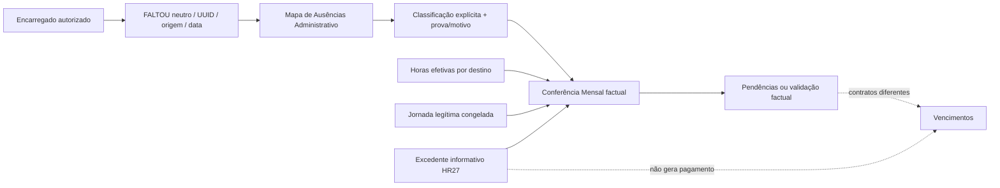

# Administrativo, RH e Viaturas

## Estado e fontes

Inventário funcional/estático da base `2ae1f8a`; produção NÃO VERIFICADA. Não se leram cadastros, nomes ou documentos pessoais reais. Os ficheiros de seed real foram excluídos da análise funcional e dos resultados; a indexação inicial extraiu só declarações, sem exportar valores. Cadastro local anterior já tinha sido implementado: não duplicar o diagnóstico desatualizado de `docs/rh-cadastro-auditoria.md` de 23/09.

## Cadastro, contrato e identidade

CONFIRMADO: `src/rh-cadastro.js:2` inclui cargo/função, nível, valor/hora, NISS separado do indicador de inscrição, contrato/tipo/início/fim, conformidade e contactos. RPCs `fn_rh_consultar`, `fn_rh_guardar`, `fn_rh_importar` (`:61`, `:77`, `:111`, `:155`). O fluxo tem preview/importação de lote; campos vazios não autorizam inventar dados. `supabase/rh_cadastro_importacao.sql:23` determina empresa pelo ator; novos caminhos não devem regressar a POST amplo de colaboradores.

Cargo formal (`colaboradores.funcao`) e perfil operacional (`utilizadores.funcao`) são conceitos distintos. Responsabilidade em `obra_responsaveis` não deve mudar contrato RH. Ligação `utilizador_id`/`auth_user_id` exige unicidade e validação; nunca inferir pelo nome. Tarifas novas usam ledger aprovado/versionado, não se deve copiar automaticamente `colaboradores.valor_hora` para esse ledger. A tabela-padrão por função/nível ainda é decisão, não funcionalidade instalada.

Contrato a prazo/estado alimenta alertas 60/45/30 dias (`bloco_07_contratos_trabalho.sql:10`). Não confundir data de saída com apagar colaborador. Reativação/ciclo de vida e viatura atribuída têm regras próprias. Histórico do contrato e contrato vigente precisam reconciliação administrativa; a missão não altera nenhum.

## Medicina

CONFIRMADO: cliente reduzido `medicine.js:2`, `:9`, `:65`; aptidão, datas, versão e documento, sem recolha clínica nova. O backend escolhe a consulta atual; cliente não substitui essa decisão ordenando livremente. Capacidade de escrita exige autorização backend e UI. Encarregado dispõe de leitura limitada pelo helper/scoped RPC, não de cadastro global.

Suite nativa Medicina executou instalação/precheck/backups/postcheck/rollback, two-connection concorrência, tenant e saída RH com dados sintéticos. Não confundir esse PASS com instalação real. O script histórico `medicina_trabalho_controlada.sql:35` exige contagem concreta de baseline; reaplicar em outro estado deverá falhar até reconciliar, não apagar o gate.

## Folha / FALTOU / ausências / conferência / Vencimentos

- CONFIRMADO: FALTOU é ocorrência neutra; não é automaticamente falta injustificada nem lança zero horas para substituir facto. Documento/justificação pendente não desaparece por retirar alguém da equipa.
- UUID original, obra e autor transitam para o mapa e histórico; classificação pelo Administrativo. O novo circuito foi desenvolvido e testado na auditoria anterior, que se reutiliza (`docs/auditoria-gestao-horas-integrada-final-20261014.md`). Não repetida a suite de 308 testes.
- Conferência mensal é validação factual de fontes/revisões. `payroll_validate` não é substituto de conferência. Correção factual invalida aprovação por fingerprint. HE HR-27 é informativa; não equivale a tarifa/pagamento de HE.
- Referência individual tem vigência e snapshot; trabalhador técnico não exige permanência operacional fictícia. Jornadas desconhecidas permanecem pendentes.
- Gestão da Plataforma é superutilizador funcional, preservando tenant, auditoria e revisão. Gerência não herda todas as ações apenas por `admin()`. Algumas capacidades frontend ainda agrupam ambos (`app.js:849`), por isso revisar capability por operação, sem alterar política nesta missão.
- V2 e equipe persistente: fontes `quadro_equipa_permanencias`, externos, `folha_registos`; Quadro do Encarregado mantém leitura. Scripts Fase B novos estão noutra branch local `chore/fase-b-readiness-20261011` / `b7bf4c158e93cf455cc307097eef83d90e9c6a77`; não estão instalados por esta missão.

## Viaturas

CONFIRMADO: frota/eventos/sinistros/multas/anexos em `vehicles.js:30`; atribuição em `vehicle-assignment.js:21`; validade em `vehicle-validity.js:1`. Edição/renovação de seguro/inspeção são distintas; usam data esperada, motivo, request_id e resposta `committed`. Não se deve repetir automaticamente gravação ambígua.

Suite nativa confirma duas ordens de concorrência atribuição↔saída, snapshot REPEATABLE READ/SERIALIZABLE, revisão, histórico, tenant e DML direto/GUC recusados. Histórico não pode perder identidade ao inativar colaborador. Os eventos de custo da frota não comprovam apropriação automática de equipamentos por tarefa/TEE; essa ligação precisa proposta específica.

## Documentos, EPI e alertas

- CONFIRMADO: Storage separado de metadata; versões de documentos/índices/PDF; guardas tenant documentais preparadas e histórico preservado. Auditar policy de bucket/objects é distinto de conceder SELECT em documentos.
- `documents.js:219` faz upload antes de inserir metadata; falha da metadata pode deixar objeto sem associação. PROVÁVEL pendência de reconciliação/compensação, não prova de órfão real. Não apagar automaticamente objetos.
- Cadastro/Medicina/ausência/EPI usam dados confidenciais com escopos diferentes; não usar diretório de colaboradores como autorização geral dos documentos.
- EPI e segurança em obra existem como secções inline do `app.js` e policies em `rls_seguranca_indices_precos.sql:12`. Entrega EPI não equivale inspeção/incidente de obra.
- Alertas visíveis têm estado, destinatário e resolução. SMTP NÃO é configurado (`bloco_09_alertas_prioridade_email.sql:2`); `enviar_email` é sinalização, sem prova de worker SMTP/entrega. Rotinas diárias foram redefinidas por vários scripts; agendamento instalado NÃO VERIFICADO.

## Achados adicionais

| ID | Prioridade/classificação | Prova | Tratamento proposto |
| --- | --- | --- | --- |
| N-ADM-07 | P2 CONFIRMADO UI sintética | `rnc.js:22` inclui Gerência e exclui Gestão; `app.js:755` passa effectiveRole que preserva Gestão (`access-control.js:83`). O render real não mostra criar RNC para Gestão. | Corrigir capability explícita numa tarefa aprovada; testar superutilizador sem dar bypass tenant. |
| N-ADM-08 | P2 CONFIRMADO data sintética | `calendar.js:4` e `vehicles.js:9` usam UTC para hoje; às 00h30 Lisboa de 15/10, instante UTC 14/10 23h30 devolve 14/10. Medicina usa Europe/Lisbon corretamente. | Helper de data civil consistente; testes meia-noite/DST. Não alterar FP-28/29 nem horas nesta missão. |
| N-ADM-09 | P2 CONFIRMADO acoplamento | `app.js:82`, `:6182`, `:6198`: empresa fixa passada a Definições/Documentos/Projetos e uploads. | Contexto de empresa autenticada explícito; validar endpoints/Storage; RLS pode recusar outra empresa, não declarar leak sem teste. |
| N-ADM-10 | P3 CONFIRMADO documentação histórica | `docs/rh-cadastro-auditoria.md:3` descreve lacunas hoje cobertas por `rh-cadastro.js` e testes; relatórios de cada época não são backlog atual. | Marcar substituído e apontar documento/commit de fecho; não criar tarefas duplicadas. |
| N-ADM-11 | P2 integração CONFIRMADA incompleta | Sinalização de email existe, entrega não implementada nos ficheiros percorridos. | Definir serviço autorizado, destinatários, rate limits e auditoria de entrega; não assumir enviar_email = email enviado. |

## Outras áreas percorridas

Agenda/Salas: colegas deduplicados e Gestão escondida do diretório conforme regra; participantes/compromissos/reservas são entidades diferentes. Reaproveitar leitor autorizado, sem consulta global a utilizadores.

Imóveis e Pedidos de Orçamento: CRUD/versões/anexos/cancelamento (`properties.js:8`, `budget-requests.js:12`). Não encontrada neste fluxo prova de conversão automática de pedido em obra/contrato; NÃO VERIFICADO requisito de integração, não bug automaticamente.

Projetos: agrupador de obras/etapas, não fusão de custos; gerir responsabilidade/permissão em cada obra. Auditoria/log (`settings.js`) e preferência visual têm gating; Log não é backup/restauro de documentos.

## Testes

28 ficheiros administrativos de regressão: 70 PASS. Dois testes nativos inicialmente SKIP por nomes de env específicos; reexecutados com binários já disponíveis: 46 PASS/0 FAIL/0 SKIP (Medicina + Viaturas, todos os subtestes). Nenhuma instalação global. Os novos renders/data civil estão nas 9 aprovações de `night-global-findings.test.mjs`. Workbook real RH, contas/revogações reais, Storage instalado e jobs são NÃO VERIFICADOS.
