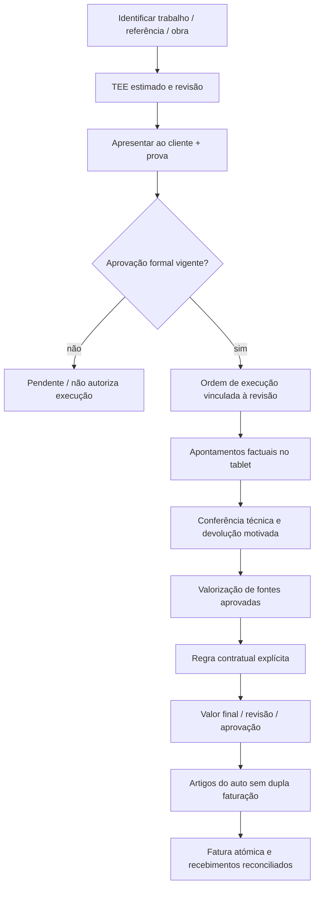

# Obra 128 — administração direta de trabalhos a mais

## Viabilidade e limite factual

PROPOSTA técnica/funcional, não implementação. Número 128 é o contexto dado por Jordane; contrato, cliente, tarefas, custos, quantidades e aprovadores reais são NÃO VERIFICADOS. Não foram lidos dados dessa obra. Não assumir percentagem de margem, preço-hora, aluguer de equipamento ou condições de faturação.

A plataforma oferece peças reutilizáveis; falta provar uma cadeia específica de execução factual→valorização→conferência→valor final→auto. Custos RH confidenciais e tabela-padrão operacional são fontes diferentes. Uma estimativa apresentada ao cliente não deve revelar tarifas RH nem constituir autorização de execução sem aprovação formal.

## Peças existentes

| Peça | Evidência | Reutilização / limite |
| --- | --- | --- |
| TEE + artigos + aprovação cliente | `supabase/tees_aprovacao_cliente_unica.sql:46`, `:66`; `src/app.js:3583` | Identificação/estimativa/revisões; precisa anexar prova formal e tratar revogação sem apagar factos |
| Tarefa vinculada ao TEE | `tees_previsao_encarregados.sql:56`; `planeamento_itens.tee_id` | Objeto operacional para Plano de Ação; N-FIN-06 precisa política de revogação |
| Folha por obra/destino | `src/attendance-hours-client.js`, `fn_folha_plano_integrado_v3` | Guardar horas uma vez; não duplicar linhas para “administrar TEE” |
| Referências Garantia/Outra | `folha_referencias_controladas.sql`; `attendance-hours-domain.js` | Associação administrativa legítima; não usar obra/Escritório fictícios |
| Materiais/MQT/lançamentos | `custos_obra_automaticos.sql:50` | Alguns lançamentos têm `tee_id`/`item_orcamento_id`; não prova captura tablet de quantidades/aprovação de consumo |
| Consulta/compra/SUB | `procurement.js`, `subempreitada_aditamentos.alteracao_tee_id` | Custos contratados/documentados; leitura de preço não autoriza comprar |
| Frota/equipamentos | `vehicles.js` + eventos/cadastro | Não foi encontrada prova de apuramento de horas de equipamento por tarefa/TEE neste fluxo |
| Autos/faturação | `app.js:4580`, `faturacao_autos_medicao` | Cabeçalhos e linhas por auto; granularidade artigo TEE→auto ainda precisa contrato e reconciliação |
| Conferência/auditoria | `folha_conferencia_mensal.sql`, `folha_historico`, `log_auditoria` | Preservar revisão/proveniência; conferência RH não substitui aprovação comercial do cliente |

## Fluxo proposto

Mudança de aprovação não apaga trabalho já feito; suspende/sinaliza novas ações e pede decisão da equipa técnica. Um apontamento factual pode precisar existir para documentar execução não aprovada; se permitido, deve permanecer como exceção para regularizar, nunca autorização comercial automática. Esta é uma decisão a aprovar.

## Entidades/relacionamentos necessários — nomes conceptuais

Não é proposta de migration nem autorização para criar tabelas.

1. **Trabalho em administração direta:** tenant/obra/TEE/revisão autorizada, escopo, artigo(s), estado, aprovadores/provas; ligação explícita a tarefa de Planeamento.
2. **Apontamento de execução:** data, tarefa/trabalho, autor, revisão, trabalhadores/externos, quantidades/unidades, materiais/equipamentos, observações e evidências. Sem preço RH no DTO do Encarregado.
3. **Apropriação de horas:** referência ao facto da Folha e parcela factual/intervalo atribuída ao trabalho; a soma das parcelas não ultrapassa horas efetivas. Duas tarefas no mesmo intervalo exigem partilha explícita, não duplicação de horas.
4. **Consumo de materiais:** quantidade/unidade, origem (stock/entrega/compra), fornecedor/documento quando existirem, devoluções/correções auditadas. Comprar, receber e consumir são eventos diferentes.
5. **Uso de equipamento:** identificação e quantidade/horas/contador, próprio/alugado, operador quando legítimo; tarifa/origem aprovada posteriormente, não introduzida por inferência.
6. **Conferência técnica:** versão factual, confirmado/devolvido, motivo, ator/data/fingerprint. Correção invalida confirmação; não altera a prova original.
7. **Valorização:** versão das fontes (padrão, adjudicação, fatura, equipamento), data de vigência, valores conhecidos/pendentes e fórmula contratual; RH privado separado.
8. **Ligação ao auto:** artigo/quantidade acumulada vs já medida/faturada, revisão valorizada, limite de aprovação; proibir dupla inclusão e arredondar segundo contrato explícito.

Tabelas atuais com FKs opcionais podem evitar duplicar entidades, mas só após validar granularidade e invariantes. `ON DELETE SET NULL` das ligações económicas não basta para provar rastreabilidade permanente; precisa guardar referência histórica na conferência/valorização.

## Interface do Encarregado — tablet, proposta

**Entrada pelo Plano de Ação:** cartão “Trabalho a mais — administração direta”, referência TEE/revisão e estado de autorização em destaque. Ação REGISTAR EXECUÇÃO. Sem margem, RH ou faturação.

**Um dia e uma tarefa:**

- Pessoas/horas: selecionar factos já registados, mostrar intervalos e horas disponíveis; adicionar apropriação sem duplicar Folha.
- Materiais: artigo, unidade e quantidade, origem documentada ou “por confirmar”; foto/documento opcional.
- Equipamento: identificação, horas/quantidade/contador; origem própria/alugada, sem preço inventado.
- Trabalho/quantidade: descrição direta, unidade conhecida, quantidade realizada, observação.
- Rodapé: CANCELAR e ENVIAR PARA CONFERÊNCIA; resumo de pessoas/horas/quantidades antes de confirmar. Editor dentro do contexto, botões grandes, sem grelha administrativa.

Sem gravar preços só por estarem sugeridos num histórico de fornecedor. Quantidade desconhecida não vira zero. Erro de rede conserva o pedido para verificação/idempotência; não repetir automaticamente um writer.

**Equipa técnica:** lista por TEE/dia/revisão, fontes/evidências e pendências; confirmar/devolver com motivo. **Administrativo/Financeiro:** só capacidades aprovadas para valorizar/emitir/cobrar; custo RH privado separado de custo-padrão operativo. **Cliente:** documento formal da versão final conforme regra contratual, não acesso ao cadastro RH.

## Decisões pendentes

- Base de preço ao cliente: preço fixo, recursos efetivos + fórmula, preços unitários ou outra regra contratual demonstrada.
- Aprovação formal e limite: quem aprova estimativa, alterações e valor final; tratamento de ultrapassagem/revogação.
- Tarifa aplicada à mão de obra: custo-padrão operativo aprovado vs fonte contratual distinta; não RH individual exposto.
- Material: consumo vs compra/entrega; devoluções e saldo; equipamento próprio/alugado e unidade/tarifa.
- Granularidade de apropriação por tarefa e consentimento de correção; execução excecional sem autorização.
- Auto: acumulação, retenção, adiantamento, parcial, IVA, arredondamento e prevenção de dupla faturação.

Recomendação: fechar regra contratual e fluxo de conferência antes de automatizar valor final. Reutilizar a Folha como facto único e criar apropriação/conferência separadas. Não criar “ponto TEE” paralelo, permanências fictícias, salários ou margens presumidos.

## Testes a preparar numa tarefa futura aprovada

Horas repartidas entre dois TEEs sem duplicação; outra obra/empresa recusada; apontamento posterior à revogação conforme regra; correção invalida conferência; preço pendente não zero; várias revisões sem duplo auto; parcial/recebimento não fecha saldo incompleto; dados RH ausentes do DTO Encarregado; duas confirmações concorrentes com um efeito. NÃO executados nesta missão porque o fluxo é proposta, não produto implementado.
