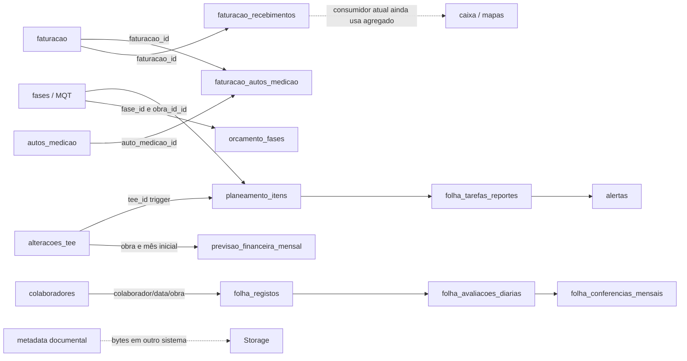

# Grafo de dependências e fontes

MATRIZ-FONTES-DE-VERDADE contém30 relações críticas com chave, origem, risco e prova. Nomes abreviados de consumidor não são FK inventadas. GRAFO-SQL-LEXICAL.json contém575 declarações,1.713 chamadas qualificadas e2.020 candidatosDDL (table/view/trigger/policy/schema/index/alter/grant/revoke/constraint). Trata sintaxe textual, não pg_depend instalado; SQL dinâmico/sobrecargas e statements multiline exigem revisão.

Nenhuma seta TEE-itens→auto granular foi comprovada; não incluída como FK. Não há nó implementado de custos-padrão independente: HR38 fonte/aprovador/vigência por fechar. Tarifas individuais confidenciais e valores padrão futuros são arquiteturas diferentes; não inferir salário do login/cargo.

## Migrations (propostas, não ordem operacional)
FolhaV2 → gestãoV2 → equipa persistente → fecho com baseline reconciliada → cutover fechado → avaliação AD15/14/13/03 → extensões HR27/FALTOU/readers/mensal/destinos/referências/plano/mapas. Checks de cada pacote determinam ordem/compatibilidade; rollback antes do uso difere após uso.

Financeiro/autos/hotfix e Storage têm dependências próprias. Um SQL antigo permissivo executado depois da restrição pode reabrir grant/policy. Branch DD-TENANT/FaseB não foi incorporada por existir localmente. Grafo não escolhe última definição por data/ordem alfabética. Sem baseline real reconstruída de documentação.
